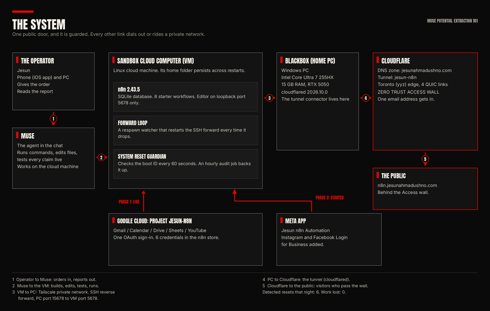

# Muse Potential Extraction 101

A self-hosted n8n, connected to everything, for $0.

Repo status: this README is the publish-ready draft for the public repo `muse-n8n-extraction-101`. Links marked as placeholders are filled when the repo and the website page go live.

## The thesis

Muse is not just a chatbot. It is a full sandbox: a powerful cloud computer in your pocket. It has its own machine, a terminal, a browser, files and memory, and scheduled jobs that run while you sleep. This repo holds the receipts from one night of real infrastructure work done with that machine, ordered from a phone:

- A self-hosted automation server (n8n) running on the cloud machine.
- Five Google services connected with one OAuth sign-in.
- A public address on a real domain, through a tunnel that runs on a home PC.
- A login wall in front of the editor that lets exactly one person in.
- Total spend: $0, on free plans only.

Every number in this repo was checked live during the build, on 2026-10-18 and 2026-10-19. The failures are documented with the fixes. Receipts, not hype.

## Architecture in one picture

The data path: a visitor opens the public address. Cloudflare checks the Zero Trust Access policy. If the visitor passes, the request rides the tunnel to the home PC. The PC passes it through a private SSH reverse forward to the cloud machine. n8n answers. No port on any machine is open to the public internet.

Parts list:

- The operator: orders and checks results from a phone.
- Muse: the agent that runs commands, edits files, tests results, and writes the reports.
- The sandbox cloud computer (VM): Linux machine, home folder persists across restarts. Runs n8n 2.43.5 (SQLite), the forward loop, and the reset guardian.
- BlackBox, the home PC: Windows (Intel Core Ultra 7 255HX, 15 GB RAM, RTX 5050). Runs cloudflared, the tunnel connector.
- Tailscale: the private network between the VM and the PC.
- Cloudflare: DNS zone, the tunnel (name jesun-n8n), the Toronto (yyz) edge, and the Zero Trust Access wall.
- Google Cloud project jesun-n8n: five APIs, one OAuth credential family, six typed credentials in the n8n store.
- Public address: n8n.jesunahmadushno.com, behind Access. It is a private editor. It will not open for you, and that is the point of the wall.

## The build, condensed

1. Start with n8n loopback-only. Version 2.43.5, local install, SQLite, editor on the machine's own loopback port 5678. Eight starter workflows in the store, all off.
2. Connect Google first. One Google Cloud project (jesun-n8n), five APIs on (Gmail, Calendar, Drive, Sheets, YouTube Data API v3), consent screen set to "In production" so refresh tokens do not die after 7 days, one OAuth client, one sign-in. Make one typed credential copy per service, because each n8n node wants its own credential type. Six credentials in the store.
3. Test like you mean it. All five services passed live API tests with real data (real inbox subjects, real events, real files, real sheet rows, the real channel at 69 subscribers at the time of the test). Three services also passed node-level tests inside n8n.
4. Try the standard tunnel on the VM. Three routes failed; see the failure table below.
5. Move the connector to the home PC. cloudflared 2026.10.0 registered 4 QUIC connections to the Toronto edge. The tunnel ingress rule sends n8n traffic to the PC's loopback port 15678.
6. Bridge the PC back to the VM. An SSH reverse forward over the private Tailscale network carries the PC's port 15678 to the VM's port 5678. A respawn loop on the VM rebuilds the forward when the SSH session drops (the runtime proxy kills quiet sessions after about a minute).
7. Move the domain DNS to Cloudflare in a safe order: zone first, records checked one by one (11 records, site and email forwarding intact), tunnel route created, nameservers changed last.
8. Put the wall up before opening the door. Zero Trust Access application "n8n Editor", one Allow policy, one email. Public end-to-end test passed.
9. The operator sets the owner account himself, through the public editor, with his own password.
10. Guard the result. A self-built reset guardian polls the machine boot ID every 60 seconds, with an hourly audit job behind it. The cloud machine restarted 6 times that night. Each restart was caught in 47 to 78 seconds. Work lost: zero.

## Failure table

| Symptom | Cause | Fix |
| --- | --- | --- |
| Quick Tunnel will not provision (HTTP 403) | Cloudflare's instant tunnel service refuses this VM | Use a named tunnel from a machine with open egress (the PC bridge) |
| Named tunnel fails on QUIC, "operation not permitted" | The VM blocks UDP egress | Run the connector where UDP is allowed |
| HTTP2 tunnel fails the TLS handshake | Sandbox DNS interception (fake-IP) makes the edge certificate name mismatch the expected name | Move the connector off the VM |
| SSH forward dies with "Broken pipe" after about a minute | The runtime proxy drops quiet SSH sessions | Respawn loop on the VM, with keep-alive traffic |
| Cloudflare error 1033 on the public address | The connector process died because it was tied to a closed SSH session | Start cloudflared detached; add a logon scheduled task |
| n8n says "already running" but the health check is empty | A stale pid file survives a crash or rotation | Remove the stale pid file, then start again |
| Browser shows NXDOMAIN for the new subdomain while public DNS passes | The browser's resolver holds the old delegation during propagation | Wait for propagation; verify with a public resolver |

## The $0 cost table

| Item | Plan | Cost |
| --- | --- | --- |
| Cloudflare DNS zone for jesunahmadushno.com | Free plan | $0 |
| Cloudflare Tunnel (jesun-n8n) | Included with the zone | $0 |
| Cloudflare Zero Trust Access ("n8n Editor" app) | Zero Trust Free (a card sits on file; $0 was due) | $0 |
| Google Cloud project jesun-n8n (5 APIs, one OAuth client) | No billing account created | $0 |
| n8n 2.43.5 | Self-hosted, open source | $0 |
| **Total spend for the build** | Free tiers only | **$0** |

The standing rule behind this table: free resources and free plans only. Any step that needs spend gets flagged and re-routed to a free path, or parked for the operator's explicit call.

## Honest limits

- The home PC is part of the chain. If the PC sleeps or is off, the public address sleeps with it. A PC reboot is covered by the scheduled task; sleep is not.
- VM rotations restart the services. n8n and the bridge loop need their restart steps after each rotation. The guardian detects and reports; the restore is scripted.
- YouTube channel read is verified. Upload through n8n is not tested yet.
- Phase 2 (Meta: Facebook Page, Instagram, Threads) has started. A developer app exists and the OAuth redirect is registered. Nothing on Meta is connected yet.
- This is a personal automation stack. It is not hosting for other people. Copy the pattern, not the claims: test every step on your own machine.

## Files map

| Path | What it holds |
| --- | --- |
| README.md | This file |
| docs/tutorial-en.md | The full English tutorial, step by step |
| docs/tutorial-bn.md | The full Bangla tutorial, an independent original, not a translation |
| docs/supporting-pack-en.md | English supporting pack: step checklist, architecture one-pager, troubleshooting table, glossary, comment-trigger explainer |
| docs/supporting-pack-bn.md | Bangla supporting pack, an independent original |
| docs/architecture-diagram.png | The system architecture chart |
| pdf/tutorial-en.pdf | The English tutorial and supporting pack, designed PDF edition |
| pdf/tutorial-bn.pdf | The Bangla tutorial and supporting pack, designed PDF edition |
| video/ | The EN and BN films, their scripts, and their storyboards |

## Links

- The tutorial on the web: https://jesunahmadushno.com/muse-n8n-extraction-101/
- The films: EN and BN editions, on the Jesun Ahmad Ushno channel (links added at publish).
- Get the pack from a post: comment TUNNEL on the launch posts and the pack arrives by DM.

## License

MIT, by Jesun Ahmad Ushno. Use the pattern, keep the receipts, credit the source.
